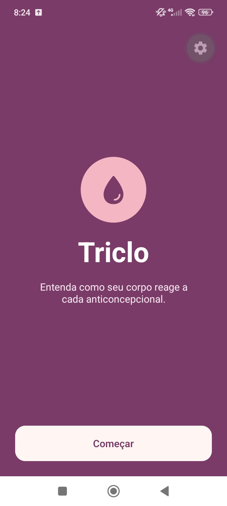
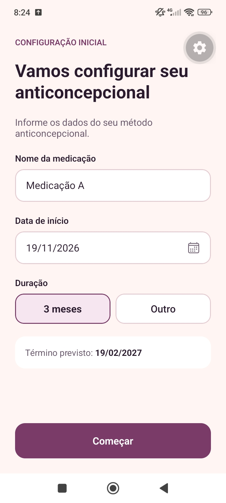
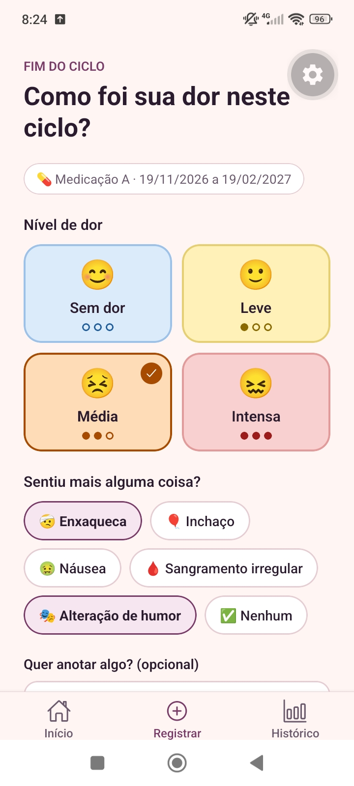
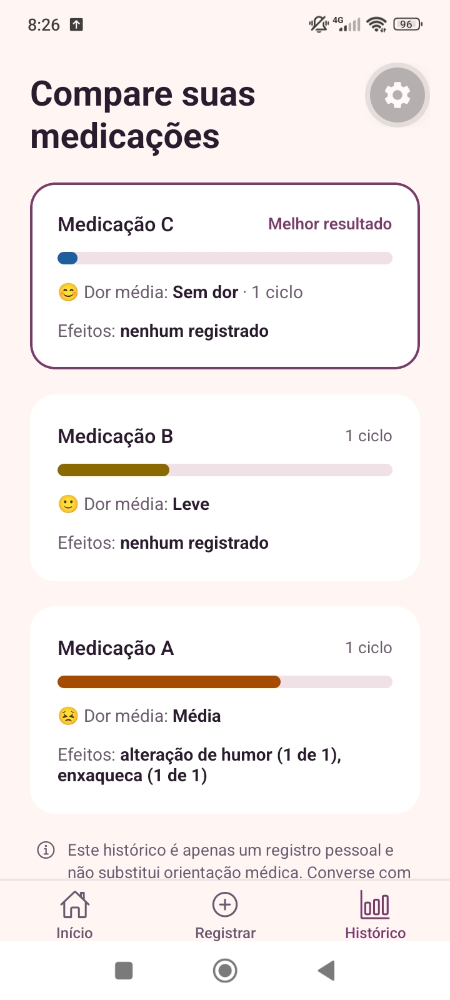

# Triclo

Aplicativo mobile para quem usa **anticoncepcional** registrar a medicação, a dor e os efeitos colaterais de cada ciclo e **comparar qual medicação funcionou melhor**.

Projeto pessoal desenvolvido para a disciplina de Desenvolvimento Mobile.

## O problema

Quem usa um anticoncepcional trimestral passa meses entre uma aplicação e outra. Nesse tempo é fácil esquecer qual medicação causou mais dor ou mais efeitos colaterais. Na hora de trocar ou de voltar a uma medicação anterior, a decisão acaba sendo feita de memória.

O Triclo guarda esse histórico no celular e mostra, lado a lado, como cada medicação se comportou.

## Funcionalidades

- **Configuração inicial:** nome da medicação, data de início e duração (3 meses ou data de término personalizada)
- **Acompanhamento do ciclo:** dia atual, progresso e datas de início e fim
- **Registro de fim de ciclo:** nível de dor (sem dor, leve, média ou intensa), efeitos colaterais e observações
- **Histórico comparativo:** dor média e efeitos mais frequentes de cada medicação, com destaque para o melhor resultado
- **Privacidade:** os dados ficam salvos apenas no aparelho, com botão para apagar tudo
- **Aviso de saúde:** o app lembra que não substitui orientação médica

## Acessibilidade

- Níveis de dor identificados por **cor, rostinho, nome e medidor de bolinhas**, e não só pela cor
- Paleta pensada para pessoas com daltonismo (azul, amarelo, laranja e vermelho-escuro)
- Rótulos de acessibilidade nos botões e campos principais

## Tecnologias

- [React Native](https://reactnative.dev/) com [Expo](https://expo.dev/)
- JavaScript
- [React Navigation](https://reactnavigation.org/) (pilha e abas)
- [AsyncStorage](https://react-native-async-storage.github.io/async-storage/) para salvar os dados localmente
- [@react-native-community/datetimepicker](https://github.com/react-native-datetimepicker/datetimepicker) para escolher datas
- [@expo/vector-icons](https://docs.expo.dev/guides/icons/) para os ícones

## Como rodar

### Pré-requisitos

- [Node.js](https://nodejs.org/) (versão LTS)
- App **Expo Go** instalado no celular
- Conta gratuita no [Expo](https://expo.dev/), caso o terminal peça login

### Passo a passo

```bash
# 1. Clone o repositório
git clone https://github.com/Brendadev01/Triclo.git
cd triclo

# 2. Instale as dependências
npm install

# 3. (se pedir) faça login no Expo
npx expo login

# 4. Inicie o projeto
npx expo start --tunnel
```

Escaneie o QR code com o Expo Go.

> O Expo Go do celular precisa ser compatível com o SDK do projeto (veja a versão de `expo` no `package.json`). O modo `--tunnel` ajuda quando o celular e o computador estão em redes diferentes ou quando a rede bloqueia a conexão.

> No Windows, se o PowerShell reclamar de execução de scripts, use o Prompt de Comando (`cmd`).

## Estrutura do projeto

```
triclo/
├── App.js
└── src/
    ├── components/     # DateField, HealthNotice, OptionButton, PainOption,
    │                   # PrimaryButton, ScreenContainer, TextField
    ├── constants/      # colors, painLevels, sideEffects
    ├── context/        # CycleContext (estado global do ciclo e dos registros)
    ├── navigation/     # AppNavigator (pilha + abas)
    ├── screens/        # Welcome, Setup, Home, Register, History
    ├── services/       # storageService (AsyncStorage)
    └── utils/          # dateUtils, historyUtils
```
## Telas

| Abertura | Início | Registrar | Histórico |
| --- | --- | --- | --- |
|  |  |  |  |

## Próximos passos

- Lembretes da próxima aplicação
- Gráficos de evolução da dor ao longo dos ciclos
- Relatório em PDF para levar ao médico
- Backup dos dados com login

## Aviso

O Triclo é um registro pessoal e **não substitui orientação médica**. Converse com seu médico antes de trocar de medicação.

## Autoria

Desenvolvido por Brendadev01.